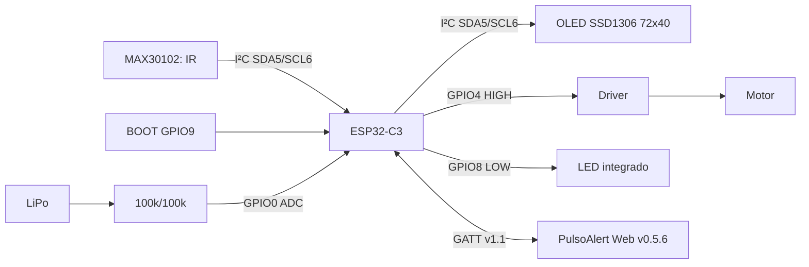
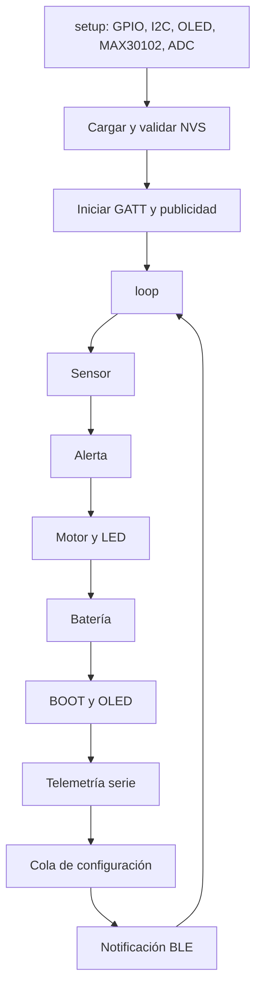
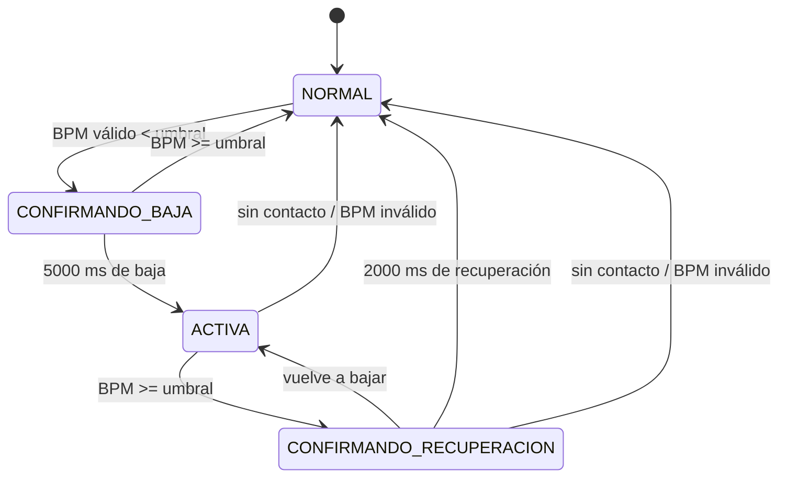

# PulsoAlert
## Manual técnico del firmware y arquitectura funcional

**Proyecto:** PulsoAlert  
**Institución:** Universidad Estatal a Distancia (UNED), Costa Rica · Fab Lab Kä Träre  
**Responsable:** Ing. Harold Carvajal Álvarez  
**Fecha de creación:** 10 de noviembre de 2026  
**Firmware de referencia probado:** v1.5.3  
**Sitio web de referencia:** PulsoAlert Web v0.5.6  
**Naturaleza:** prototipo experimental y educativo, no dispositivo médico


> **Alcance técnico.** Este manual describe la implementación real del sketch `PulsoAlert_v1.5.3.ino`, su estructura funcional, contrato BLE y limitaciones observadas. Los diagramas y prototipos son representaciones documentales derivadas del código, no fotografías ni pruebas instrumentadas.

## 1. Propósito y límites del sistema

PulsoAlert es un firmware cooperativo para ESP32-C3 que integra lectura óptica, estimación experimental de BPM, detección de contacto, alerta de frecuencia baja, control de actuadores, visualización OLED, supervisión de voltaje LiPo y comunicación BLE con configuración persistente. No existe validación clínica del algoritmo ni autenticación BLE en la versión documentada.

La referencia web asociada es **PulsoAlert Web v0.5.6**. El código del sitio y sus simuladores se documentan por separado en el área WebBLE. La arquitectura eléctrica completa y las fotografías de montaje pertenecen al área Hardware.

## 2. Estructura del código fuente

| Bloque del sketch | Símbolos y funciones principales | Responsabilidad |
|---|---|---|
| 1. Hardware | `PIN_SDA`, `PIN_SCL`, `PIN_MOTOR`, `PIN_LED`, `PIN_BOOT`, `PIN_BATERIA` | Asignación de pines y polaridades |
| 2. Medición | `IR_MINIMO`, `muestrasBPM`, `actualizarSensor()`, `reiniciarMediciones()` | Contacto, detección de latidos y promedio BPM |
| 3. Alertas | `EstadoAlerta`, `EstadoMotor`, temporizadores | Parámetros y estados de actuación |
| 4. Motor y LED | `iniciarMotor()`, `actualizarMotor()`, `iniciarLED()`, `actualizarLED()` | Patrones no bloqueantes |
| 5. Máquina de alerta | `activarAlerta()`, `cancelarAlerta()`, `actualizarAlerta()` | Confirmación, recuperación y cancelación |
| 6. Batería | `leerVoltajeBateria()`, `clasificarBateria()`, `actualizarBateria()` | ADC, filtros y estado energético |
| 7. Interfaz | `actualizarBotonBoot()`, `mostrarPantallaPrincipal()`, `mostrarPantallaConfiguracion()`, `actualizarOLED()` | Navegación y renderizado |
| 8. Diagnóstico | `actualizarSerial()` | Telemetría por USB CDC cada 2 s |
| 9. BLE y NVS | `cargarConfiguracion()`, `EventosEscrituraBLE`, `procesarSolicitudBLE()`, `publicarMedicionBLE()`, `iniciarBLE()`, `actualizarBLE()` | Transporte GATT y persistencia |
| 10. Ejecución | `setup()`, `loop()` | Inicialización y planificación cooperativa |

La numeración de comentarios internos del sketch es histórica y puede repetir un número de sección. La tabla anterior organiza conceptualmente los módulos sin modificar el archivo fuente.

## 3. Arquitectura de señales



**Alcance del diagrama:** las señales GPIO están documentadas y verificadas; no constituye esquema eléctrico completo del sistema de alimentación o protección LiPo.

## 4. Inicialización y planificación del firmware

`setup()` abre la consola a 115200 baudios, inicializa GPIO, ADC, I²C, OLED, sensor, batería, parámetros NVS y servidor BLE. El sensor se inicia con `sensor.begin(Wire, I2C_SPEED_FAST)` y `sensor.setup()` sin parámetros; los ajustes ópticos individuales dependen de los valores predeterminados de la biblioteca instalada. La OLED utiliza `U8G2_SSD1306_72X40_ER_F_HW_I2C` y dirección `0x3C × 2` en la API de U8g2.

El `loop()` ejecuta, en este orden, sensor, alerta, motor, LED, batería, botón, OLED, consola, cola de configuración BLE y publicación BLE. Cada función consulta `millis()` para actuar únicamente cuando corresponde. No se utilizan `delay()` en la ejecución normal de los actuadores; existe un `delay(1000)` deliberado en el bucle de fallo crítico de inicialización del sensor.



## 5. Algoritmo óptico y estimación de BPM

1. `sensor.getIR()` obtiene una muestra infrarroja de la señal reflejada.
2. Si `IR < 50000`, se considera ausencia de contacto y se reinician las muestras.
3. Si existe contacto, `checkForBeat(ir)` identifica eventos de latido a partir de la señal óptica.
4. El intervalo entre eventos se mide con `millis()`: **BPM = 60 000 / intervalo_ms**.
5. Se admiten valores instantáneos en el intervalo **20–220 BPM**.
6. Los últimos **hasta cuatro** BPM válidos se guardan en un arreglo circular y se promedian.
7. Si transcurren **más de 4000 ms** sin latido, la medición se invalida.

El algoritmo no calcula una métrica independiente de calidad de señal; el umbral IR solo estima contacto. La señal puede verse afectada por movimiento, presión, luz ambiental y posicionamiento sobre la muñeca. La variable histórica `dedoPresente` representa contacto óptico aunque la interfaz utilice el texto apropiado para pulsera `SIN CONTACTO`.

## 6. Máquina de estados de frecuencia baja



| Estado | Condición | Efecto |
|---|---|---|
| `NORMAL` | BPM normal o ausencia de episodio | Salidas sin alerta |
| `CONFIRMANDO_BAJA` | BPM válido inferior al umbral | Cuenta 5000 ms |
| `ACTIVA` | Baja confirmada | Inicia motor y LED, prioriza OLED principal |
| `CONFIRMANDO_RECUPERACION` | BPM volvió al umbral o superior | Cuenta 2000 ms; alerta sigue activa |

La pérdida de señal cancela el episodio; no genera una alerta de BPM bajo. El umbral inicial es 50 BPM y el rango de escritura BLE es 30–120 BPM.

## 7. Temporización de motor y LED

El motor implementa la máquina `INACTIVO → PULSO → PAUSA_PULSO → PAUSA_CICLO → TERMINADO`. Cada ciclo contiene tres pulsos de 300 ms y dos pausas internas de 200 ms; después se aplica una pausa de 1000 ms antes de otro ciclo. El máximo inicial es tres ciclos, configurable entre uno y cinco. La salida GPIO4 controla el driver del motor; no alimenta directamente el motor.

```text
Tiempo ilustrativo (ms)       0    300  500  800 1000 1300 2300
Motor, ciclo 1               [ON] OFF [ON] OFF [ON]   OFF...
Duración de cada ON: 300 ms; pausa entre ON: 200 ms
Pausa entre ciclos: 1000 ms (después de terminar el ciclo)
```

El LED GPIO8 es **activo LOW** y tiene un temporizador independiente desde `inicioLED`. Utiliza un patrón equivalente al motor, pero puede seguir parpadeando después de que el motor complete sus ciclos. Duración inicial: 2 minutos; rango remoto: 1–10 minutos. Si se confirma recuperación o desaparece una señal válida, se apagan ambos actuadores. Los cambios de configuración durante una alerta activa pueden modificar los límites temporales del episodio en curso.

## 8. Batería y clasificación energética

El ADC GPIO0 mide la salida del divisor 100 kΩ / 100 kΩ. La tensión reconstruida se calcula como:

**V_batería = promedio(analogReadMilliVolts(GPIO0), 16) / 1000 × 2,0 × 1,0**.

Se actualiza cada 2000 ms. El estado se clasifica con **BAJA <3,50 V** y **CRÍTICA <3,30 V**, y exige 10 s de estabilidad para cambiar de categoría. Los umbrales son orientativos y no sustituyen el circuito de protección de la LiPo. La calibración 1,0 no representa una certificación metrológica; la comparación sistemática con multímetro sigue siendo una mejora posible.

En BLE se transmite voltaje en **milivoltios** y el campo de porcentaje conserva el valor **255 = desconocido**. No existe estimación calibrada de porcentaje de carga.

## 9. Visualización OLED: diseño y estados

Pantalla SSD1306 de **72 × 40 píxeles**, actualizada cada **200 ms** mediante búfer de U8g2. Fuentes efectivas del código: `u8g2_font_5x7_tr`, `u8g2_font_5x7_tf` y `u8g2_font_helvB14_tr` para BPM grandes. La pantalla principal reserva la línea superior para el estado, el centro para BPM y la inferior para batería. El botón BOOT cambia a la vista de configuración; la alerta tiene prioridad visual.

### Prototipos de interfaz (esquemáticos, no capturas de hardware)

```text
┌──────────────────────┐  ┌──────────────────────┐
│ MONITOREO            │  │ LEYENDO...           │
│                      │  │                      │
│  72 BPM              │  │ -- BPM               │
│ BAT: OK              │  │ BAT: OK              │
└──────────────────────┘  └──────────────────────┘

┌──────────────────────┐  ┌──────────────────────┐
│ CONFIG.              │  │ ALERTA FC!           │
│ BAT: 3.92V           │  │                      │
│ UMB: 50 BPM          │  │  45 BPM              │
│ BOOT: VOLVER         │  │ BAT: BAJA            │
└──────────────────────┘  └──────────────────────┘
```

Los ejemplos 72 BPM, 45 BPM y 3,92 V son **valores de demostración**, no datos observados en una prueba. En la pantalla real el ancho de la etiqueta BPM se calcula con `getStrWidth()` para evitar desbordamiento horizontal.

## 10. Bluetooth Low Energy: servicio y características

El dispositivo anuncia **`PulsoAlert`** y el servicio **`f0a10000-7b4d-4c6a-9e20-3b8c8f100001`**. Las cinco características conservan el sufijo `-7b4d-4c6a-9e20-3b8c8f100001`:

| Característica | UUID (prefijo) | Propiedades | Datos |
|---|---|---|---|
| `MEASUREMENT` | `f0a10001` | Read / Notify | 8 bytes |
| `BPM_THRESHOLD` | `f0a10002` | Read / Write | uint16 little-endian, 30–120 |
| `VIBRATION_CYCLES` | `f0a10003` | Read / Write | uint8, 1–5 |
| `LED_DURATION` | `f0a10004` | Read / Write | uint16 little-endian, minutos 1–10 |
| `CONFIG_STATUS` | `f0a10005` | Read / Notify | 4 bytes |

### Paquete `MEASUREMENT` GATT v1.1

| Bytes | Tipo | Semántica |
|---|---|---|
| 0–1 | uint16 LE | BPM; 0 indica valor inválido |
| 2 | uint8 | Contacto: 0 no, 1 sí |
| 3 | uint8 | Batería porcentual: 255 desconocido |
| 4 | uint8 | Alerta: 0 no, 1 sí |
| 5 | uint8 | Estado: 0 esperando contacto, 1 BPM válido, 2 señal sin BPM válido |
| 6–7 | uint16 LE | Voltaje de batería en mV; 0 no disponible |

La publicación se realiza aproximadamente cada **1000 ms**. El formato de ocho bytes amplía el de seis bytes de GATT v1.0. Una web que valide exactamente seis bytes rechazará el nuevo paquete, como ocurrió en una prueba anterior.

### Escritura, validación y respuesta

El callback `EventosEscrituraBLE::onWrite()` copia la solicitud a una **cola FreeRTOS de capacidad ocho**. El bucle principal extrae solicitudes sin espera, valida longitud y rango, escribe en NVS y solo después actualiza el valor efectivo. La característica `CONFIG_STATUS` notifica cuatro bytes: **resultado**, **parámetro**, **valor vigente uint16 LE**. Códigos de resultado: 0 inicial, 1 guardado, 2 inválido, 3 error NVS. Identificadores: 0 ninguno, 1 umbral, 2 ciclos, 3 LED.

```mermaid
sequenceDiagram
  participant Web as WebBLE
  participant CB as Callback BLE
  participant Q as Cola FreeRTOS
  participant Loop as Loop principal
  participant NVS as Preferences/NVS
  Web->>CB: Write parámetro
  CB->>Q: Encolar solicitud
  Loop->>Q: Extraer sin espera
  Loop->>Loop: Validar longitud y rango
  alt Válida
    Loop->>NVS: Persistir
    NVS-->>Loop: Resultado
    Loop-->>Web: CONFIG_STATUS (guardado/error)
  else Inválida
    Loop-->>Web: CONFIG_STATUS (inválido)
  end
```

**Persistencia:** namespace `pulsoalert`; claves `umbral` (`uint16`), `ciclos` (`uint8`) y `ledmin` (`uint16`). Valores predeterminados: 50 BPM, 3 ciclos y 2 min. Se recuperan antes de iniciar BLE. La confirmación de persistencia tras reiniciar proviene de pruebas comunicadas por el responsable del prototipo.

## 11. Diagnóstico USB CDC: incidencia abierta

La fuente v1.5.3 conserva `actualizarSerial(ahora)` en `loop()`. Esa función imprime datos cada **2000 ms**. Durante pruebas, cerrar el monitor serie provocó que la OLED se congelara después de aproximadamente dos segundos; reabrirlo restablecía la actualización. Al comentar la llamada a `actualizarSerial(ahora)`, el sistema siguió funcionando correctamente. Añadir una comprobación `if (!Serial)` no resolvió la incidencia. Una propuesta posterior basada en `availableForWrite()` **no tiene confirmación de prueba**.

La correlación con el período de telemetría y el resultado del aislamiento señalan la ruta de salida serie como factor causal probable, pero no prueban un bloqueo interno específico del controlador USB. No debe describirse como resuelto ni sustituirse la fuente aprobada por una modificación no validada.

**Protocolo de reproducción de incidencia:** compilar fuente original; observar OLED con monitor abierto; cerrar monitor y esperar 20 s; registrar actualización de pantalla y BLE; volver a abrir monitor; repetir con una copia experimental que desactive únicamente la llamada serie; comparar resultados. Las pruebas de diagnóstico deben realizarse sobre una copia, no sobre el archivo original de referencia.

## 12. Validación y trazabilidad de versiones

| Versión | Cambio funcional | Evidencia |
|---|---|---|
| v1.4.2 | Base óptica, OLED, batería y alertas; LED corregido | Probado históricamente |
| v1.5.0 | Notificaciones BLE de BPM/alertas | Confirmación de funcionamiento con web |
| v1.5.1 rev. A | Configuración, NVS, GATT v1.1, prototipos explícitos | Compilación y carga confirmadas; incompatibilidad temporal con web antigua |
| **v1.5.3** | Identificación de versión y continuidad de la lógica anterior | Web, batería y persistencia confirmadas; problema serie aún abierto |

La versión **PulsoAlert Web v0.5.6** se incorpora como referencia de integración proporcionada para esta edición; su código no se analiza ni se reproduce aquí.

## 13. Seguridad y límites

- La salida GPIO4 gobierna el **driver**, no el motor directamente.
- GPIO0 recibe la **salida del divisor**, no los 3,7–4,2 V directos de la LiPo.
- La protección y carga de batería requieren componentes adecuados y polaridad verificada.
- No mantener BOOT presionado al iniciar el equipo.
- El firmware no cuenta con autenticación BLE y no está diseñado para entornos con exigencias de confidencialidad o integridad clínica.
- La medición óptica de muñeca no está validada clínicamente y no debe utilizarse para decisiones médicas.

## 14. Referencias documentales y de código

- Fuente primaria: `PulsoAlert_v1.5.3.ino` (sin modificaciones).
- Contrato compartido: `PulsoAlert_Contrato_BLE_v1.1.md`.
- Consolidación previa: `PulsoAlert_Documentacion_Firmware.md`, `PulsoAlert_Inventario_Firmware.md`.
- Sitio: https://fablabkatrare.github.io/PulsoAlertPage/
- Arduino-ESP32: https://docs.espressif.com/projects/arduino-esp32/en/latest/
- U8g2: https://github.com/olikraus/u8g2
- SparkFun MAX3010x: https://github.com/sparkfun/SparkFun_MAX3010x_Sensor_Library

## 15. Descargo de responsabilidad

PulsoAlert es un prototipo de investigación aplicada y educación tecnológica del Fab Lab Kä Träre, UNED, Costa Rica. La estimación de frecuencia cardíaca, los avisos hápticos y luminosos y la lectura energética son experimentales; no se dispone de certificación médica, ensayos de precisión clínica ni garantías de disponibilidad continua. La pérdida de señal, los movimientos y los problemas de alimentación o firmware pueden producir lecturas erróneas o ausencia de aviso. El uso debe limitarse a demostraciones y actividades educativas bajo condiciones seguras. La documentación no autoriza empleo médico ni sustituye la documentación de seguridad de los componentes.
